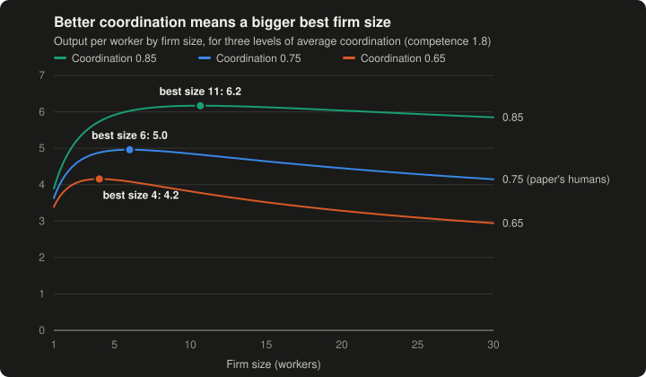

<a href="/">← Back</a>

*Thoughts on "Organizing Intelligence" by Alex Imas, Andrew Koh, and Shane Legg (Google DeepMind, October 2026).*

On October 29th 2026, Google DeepMind has published the article *organizing intelligence* which postulates how AI will bring changes to the economic systems we have today. The article completely dodges the possibility of a super intelligent AI destroying humanity altogether. Instead it treats AI as new cheap workers pouring into the economy and competing with humans for tasks and jobs.

The proposed economic model divides work into two parts: **Competence** and **Coordination**. 

***

**Competence** is the set of skills a worker has to perform their domain-specific work and it can be made up of a vector $$y = (y_1, y_2, \ldots, y_n)$$, with one entry per skill domain. This is also where most AI-benchmarks are concentrated as these are small tasks that have a concrete objective in themselves.

The paper describes a firm as a measure $$\nu$$ over the skill profiles of its workers, with size $$m = \nu(Y)$$. The firm's average skill in domain $$j$$ is

$$
\bar{y}_j = \frac{1}{m} \int_Y y_j \, d\nu(y)
$$

which for a regular team is just the plain average of its members' skill in that domain. A firm's competence $$L$$ is then the harmonic mean of these average skills $$(\bar{y}_1, \bar{y}_2, \ldots, \bar{y}_n)$$:

$$
L = \frac{n}{\displaystyle\sum_{j=1}^{n} \frac{1}{\bar{y}_j}}
$$

<small><em>What the harmonic mean is really saying: if one average skill sucks, everything sucks.</em></small>

For example, take a company that is great at engineering and design, with an average skill of 9 in both, but bad at sales, with an average of 1:

$$
L = \frac{3}{\dfrac{1}{9} + \dfrac{1}{9} + \dfrac{1}{1}} = \frac{27}{11} \approx 2.45
$$

A plain average would score this company at 6.3, but its competence is only 2.45: the weak sales team drags down everything else. Raising sales from 1 to just 3 would more than double $$L$$ to 5.4.

  

In other words, in this model the weakest link of the chain snaps the company's competence. This is unlikely to be literally true in real life, but it is a reasonable modelling choice.

***

**Coordination** is a worker's ability to work and communicate with others. Each worker has a single coordination skill $$y_*$$, and the firm's average is $$\bar{y}_*$$. It governs how productivity changes as the firm grows. Output per worker in a firm of $$m$$ workers is:

$$
\frac{F}{m} = \underbrace{L}_{\text{competence}} \times \underbrace{e^{\phi m/(1+m)}}_{\text{dividing work}} \times \underbrace{(1+m)^{\bar{y}_*}}_{\text{building on colleagues}} \times \underbrace{\frac{1}{1+m}}_{\text{split attention}}
$$

Dividing work helps a lot at first and then levels off, with $$\phi$$ controlling how big that gain is. Each worker builds on what colleagues produce, at a rate set by $$\bar{y}_*$$, but their attention is split across more and more people. While $$\bar{y}_* < 1$$, the split attention eventually wins, so output per worker peaks at a best firm size:

$$
m^* = \frac{\phi}{1 - \bar{y}_*} - 1
$$

With the paper's numbers, $$\phi = 7/4$$ and human coordination of $$3/4$$, the best firm size is 6. Competence $$L$$ does not appear in this formula: it lifts output at every size but does not change the best size. Only coordination does.

For example, take the paper's coders, with competence $$L = 1.8$$ and coordination $$\bar{y}_* = 3/4$$. Grouped into a firm of 6, each one produces:

$$
\frac{F}{m} = 1.8 \times e^{1.75 \times 6/7} \times 7^{0.75} \times \frac{1}{7} \approx 5.0
$$

Working alone ($$m = 1$$), the same coder produces only 3.6. But bigger is not always better: in a firm of 20, output per worker falls back to about 4.5, because attention is now split across too many colleagues.

  

***

**Mixed firms score better.** A direct consequence of the two formulas is that a firm mixing different kinds of workers beats a firm of identical ones. The paper's economy has coders with skills $$(9, 1)$$ in coding and writing, and writers with $$(1, 9)$$. A firm of only coders, or only writers, has competence 1.8. A firm with equal shares of both averages $$(5, 5)$$:

$$
L = \frac{2}{\dfrac{1}{5} + \dfrac{1}{5}} = 5
$$

Nobody in that firm is good at both skills, yet its competence is almost three times that of any member. The paper calls this *mosaic intelligence*. Coordination is the same $$3/4$$ for coders and writers, so the best firm size stays at 6, but output per worker in a six-person firm jumps from 5.0 to 13.8.

The same logic applies to coordination. The paper adds a third type of worker, the coordinator, who is bad at both skills, $$(1, 1)$$, but has coordination of $$0.97$$. Adding one coordinator to six specialists lowers the firm's competence a little but raises its average coordination, so the best firm size grows from 6 to 7. The worker who would score last on any individual test still makes the team better.

Figure 3 of the paper places these firms on a map of competence against coordination:

  
   
  <small><em>Figure 3 from Imas, Koh and Legg, "Organizing Intelligence" (2026). The dashed orange circle is my addition: it marks where I think AI is today.</em></small>

A lone coder or writer sits at the bottom left, with competence 1.8. The mosaic team moves far to the right, to competence 5, at the same coordination. Adding a coordinator moves the team up and slightly to the left. The values 1.69 and 0.78 on the axes are the average competence and coordination of the humans working alone. The shaded regions are where the paper goes next: the different regimes of AI, defined by where its competence and coordination sit relative to the humans.

***

**The AI regimes.** In the model, an AI is just another kind of worker, with its own competence and coordination, except that a firm can run as many copies of it as it wants, at a fixed compute cost per copy. The paper splits the map above into four regimes, using two thresholds: whether the AI beats the best human at every task (competence above 9), and whether its coordination is above 1.

| Regime | Competence | Coordination |
|---|---|---|
| Minimal AGI | At least the human average, not above the best human | Below 1 |
| Supercompetent AI | Above every human | Below 1 |
| Supercooperative AI | Not above the best human | Above 1 |
| ASI | Above every human | Above 1 |

The coordination threshold of 1 comes straight from the coordination formula. Below 1, split attention eventually wins and there is a best firm size. Above 1, the term $$(1+m)^{\bar{y}_* - 1}$$ keeps growing, so output per worker rises with firm size forever: a bigger firm is always better.

The paper's economy has two markets: a deep one with a lot of demand and a small niche one. This is what happens to the 14 humans in each regime:

- **Minimal AGI.** The AI matches the average human working alone, and AI firms have a best size of about seven copies. Every human keeps their job, because mixed human teams still beat the AI. But the extra supply lowers prices, so wages fall: specialists go from 4.15 to 2.90 and coordinators from 2.41 to 1.30.
- **Supercompetent AI.** Each copy produces more, but the best AI firm size is still about seven, because coordination did not change. Coordinators become the valuable humans: they work with the AI in the deep market and earn more than the specialists (0.48 against 0.39), who move to the niche market.
- **Supercooperative AI.** With coordination above 1, the deep market concentrates into one giant AI firm, even if the AI's task skills are modest. Specialists keep working in the niche market, but some coordinators lose their jobs, since coordinating is exactly what the AI is now good at.
- **ASI.** One giant AI firm supplies the deep market. Specialists still work in the niche market, by comparative advantage: they are worse than the AI at everything, but cheap enough to be worth employing. Coordinators are unemployed.

The pattern across the four is that competence and coordination do different damage. Better AI competence makes production cheaper and shifts which human skills are scarce. Better AI coordination changes the size of firms, and past the threshold of 1 it removes the limit on firm size altogether. The paper is careful to say that the ASI case only describes AI just past the threshold; it does not consider what happens to human jobs if ASI keeps improving.

***

**What this means for jobs and wages.** If we are where I circled in the figure, with AI at high task competence but low coordination, the model makes some specific predictions. The paper's own reading of the evidence is similar: current AI has uneven competence that often beats human experts, while teams of AI agents still scale badly.

The first prediction is about firms. Best firm size depends only on coordination, so more competent AI does not create giant AI firms. Firms get more productive and change who they hire, but they do not grow. If anything they shrink: the paper cites evidence that AI-native startups employ about 25% fewer people than similar startups.

The second is about wages. In the model, what a firm is willing to pay a human with capabilities $$y$$ is:

$$
b(y) = r + \beta \cdot (y - y^M)
$$

Here $$r$$ is the cost of running one copy of the AI, $$y^M$$ is the AI's capabilities, and $$\beta$$ is how much the firm values each capability. In words: a human is worth the cost of the AI that could replace them, plus a premium for whatever they have that the AI lacks. As AI task competence rises, the gap in task skills closes and that part of the premium disappears. The gap in coordination is what is left.

That gives a clear picture of who wins and who loses:

- **People paid for coordination do well.** In the supercompetent regime, coordinators earn more than specialists, because one coordinator raises the output of many capable AI copies.
- **People paid for task skills alone lose their premium.** Junior workers are the closest to what the AI already does, so their wages get squeezed first. The paper cites junior employment in exposed occupations falling between 7.7% and 19%, while senior employment and pay hold or rise.
- **People who work alone are the most exposed.** A freelancer has no coordination role to fall back on. Job volume and earnings on online freelance platforms fell after AI arrived.

The third is that wages can fall before jobs do. In the paper's minimal AGI example every human stays employed, but pay drops because AI makes output cheaper. Unemployment is not the first symptom to look for.

All of this holds only while AI coordination stays below 1. Once AI agents can work together well enough that bigger teams are always better, the model flips: one giant AI firm, and coordinators are the ones who lose their jobs. So the number to watch is not how well a model scores on a benchmark, which measures competence, but how well many copies of it work together.

